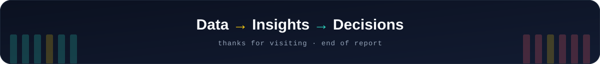

<!-- ════════════════════════════════════════════════════════════════
     kumar_raju_profile.pbix — a GitHub profile built like a BI report
     ════════════════════════════════════════════════════════════════ -->

<p align="center">
  
</p>

<p align="center">
  
</p>

<p align="center">
  <a href="https://www.linkedin.com/in/kumar-raju-neela"></a>
  <a href="mailto:neelakumarraju@gmail.com"></a>
  <a href="https://portfolio-six-tau-96.vercel.app/"></a>
  <a href="https://github.com/KumarRaju1313?tab=repositories"></a>
</p>

<!-- report page tabs -->
<p align="center">
  <a href="#about"></a>
  <a href="#pipeline"></a>
  <a href="#toolbox"></a>
  <a href="#focus"></a>
  <a href="#analytics"></a>
</p>

<br />

<a name="about"></a>

## 🧾 Page 1 · About Me

> Every analyst starts with a query — so here is mine.

```sql
-- 👋 Hi there! Run this query to get to know me.
SELECT  name, role, company, education, experience,
        upskilling, toolkit, open_to
FROM    data_professionals
WHERE   github = 'KumarRaju1313';
```

<sub>▶ Query executed successfully · <b>1 row returned</b></sub>

| column | value |
|:--|:--|
| `name` | **Neela Kumar Raju** |
| `role` | Executive – MIS |
| `company` | HBL Engineering Ltd. |
| `education` | B.Com Graduate |
| `experience` | MIS reports, dashboards, data reconciliation, automation & management insights — across multiple industries |
| `upskilling` | Data Science & AI · Innomatics Research Labs |
| `toolkit` | Python · SQL · Excel · Power BI · Machine Learning · Deep Learning · NLP |
| `open_to` | Data Analytics · Business Intelligence · MIS · Data Science roles |

> [!TIP]
> **Open to new opportunities** in Data Analytics, Business Intelligence, MIS and Data Science.
> The quickest way to reach me is [LinkedIn](https://www.linkedin.com/in/kumar-raju-neela) or [email](mailto:neelakumarraju@gmail.com).

<br />

<a name="pipeline"></a>

## 🔄 Page 2 · Data Pipeline

<sub>How I take messy business data and turn it into decisions people can act on.</sub>

<p align="center">
  
</p>

<br />

<a name="toolbox"></a>

## 🧰 Page 3 · Toolbox

<table>
  <tr>
    <td width="210"><b>🗄️ Query &amp; Store</b></td>
    <td>
      
      
    </td>
  </tr>
  <tr>
    <td><b>🐍 Code &amp; Clean</b></td>
    <td>
      
      
      
    </td>
  </tr>
  <tr>
    <td><b>🤖 Model &amp; Predict</b></td>
    <td>
      
      
      
      
    </td>
  </tr>
  <tr>
    <td><b>📊 Report &amp; Visualize</b></td>
    <td>
      
      
      
    </td>
  </tr>
</table>

<br />

<a name="focus"></a>

## 🎯 Page 4 · Focus Areas

<table>
  <tr>
    <td align="center" width="25%">📊<br /><b>MIS Reporting</b><br /><sub>Management dashboards</sub></td>
    <td align="center" width="25%">📈<br /><b>Power BI</b><br /><sub>Dashboard development</sub></td>
    <td align="center" width="25%">📑<br /><b>Advanced Excel</b><br /><sub>Reporting &amp; automation</sub></td>
    <td align="center" width="25%">🔄<br /><b>Reconciliation</b><br /><sub>Data validation</sub></td>
  </tr>
  <tr>
    <td align="center">🧹<br /><b>Data Cleaning</b><br /><sub>Transformation</sub></td>
    <td align="center">🐍<br /><b>Python</b><br /><sub>Data analysis</sub></td>
    <td align="center">🤖<br /><b>Machine Learning</b><br /><sub>Predictive analytics</sub></td>
    <td align="center">💡<br /><b>Business Intelligence</b><br /><sub>Decision support</sub></td>
  </tr>
</table>

<br />

<a name="analytics"></a>

## 📈 Page 5 · GitHub Analytics

<p align="center">
  
  
</p>

<p align="center">
  <picture>
    <source media="(prefers-color-scheme: dark)" srcset="https://raw.githubusercontent.com/KumarRaju1313/KumarRaju1313/main/profile/snake-dark.svg" />
    <source media="(prefers-color-scheme: light)" srcset="https://raw.githubusercontent.com/KumarRaju1313/KumarRaju1313/main/profile/snake-light.svg" />
    
  </picture>
</p>

<sub>The language card and the snake are rebuilt every day by a GitHub Action in this repo, so they never show a broken image.</sub>

<br />
<br />

<p align="center">
  <a href="https://portfolio-six-tau-96.vercel.app/"></a>
</p>

<p align="center">
  
</p>

<p align="center">
  
</p>
